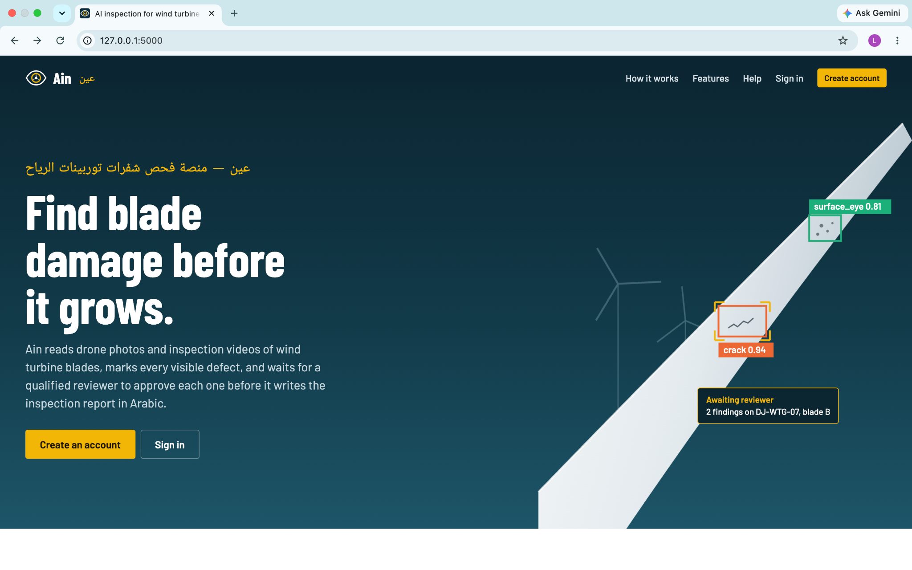
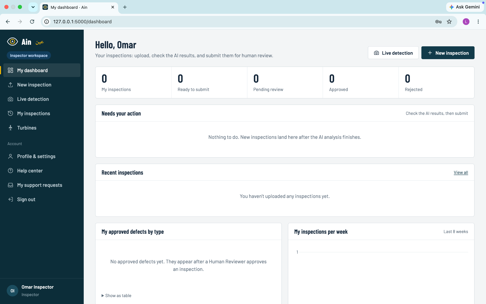
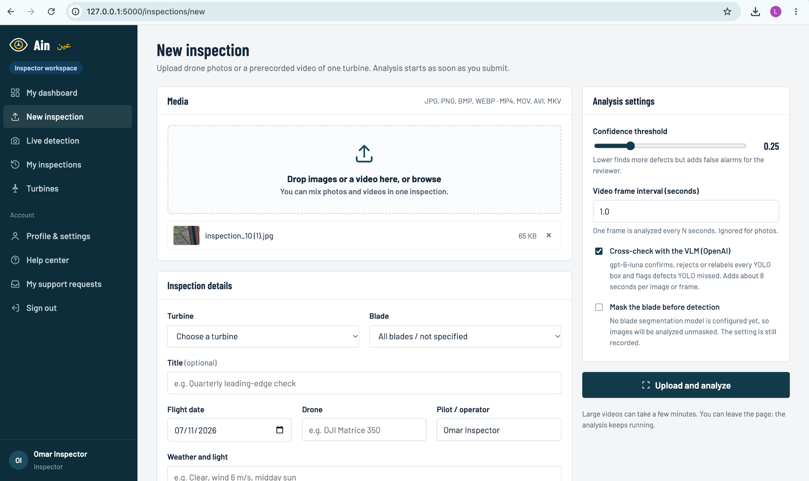
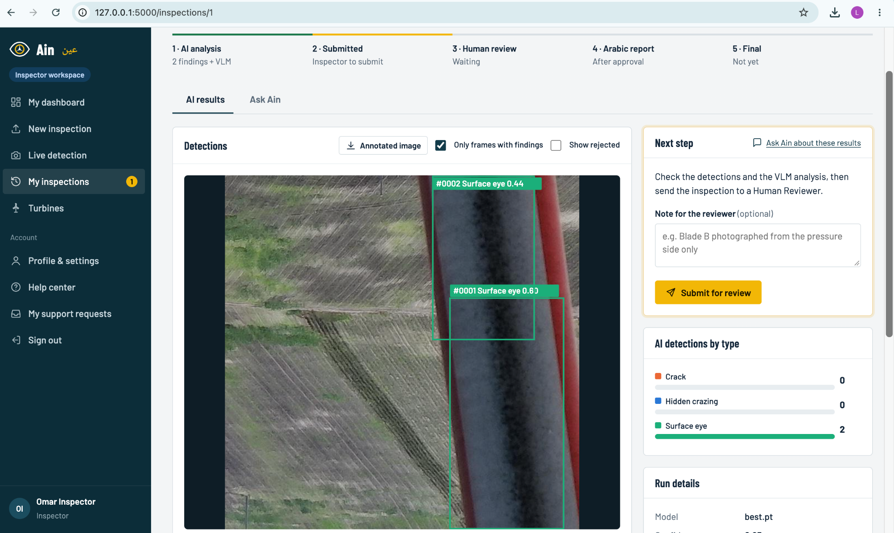
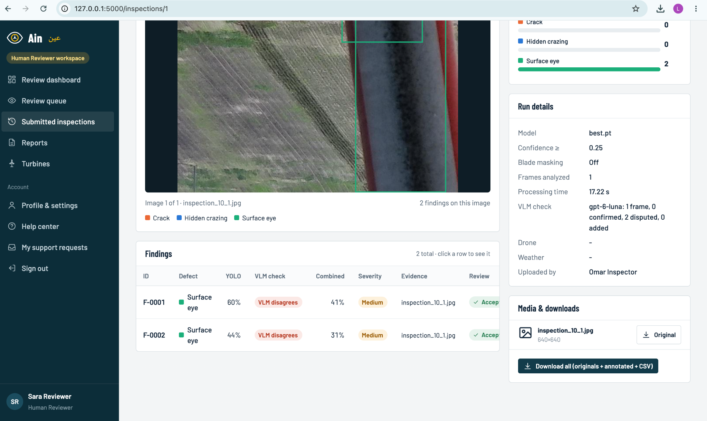
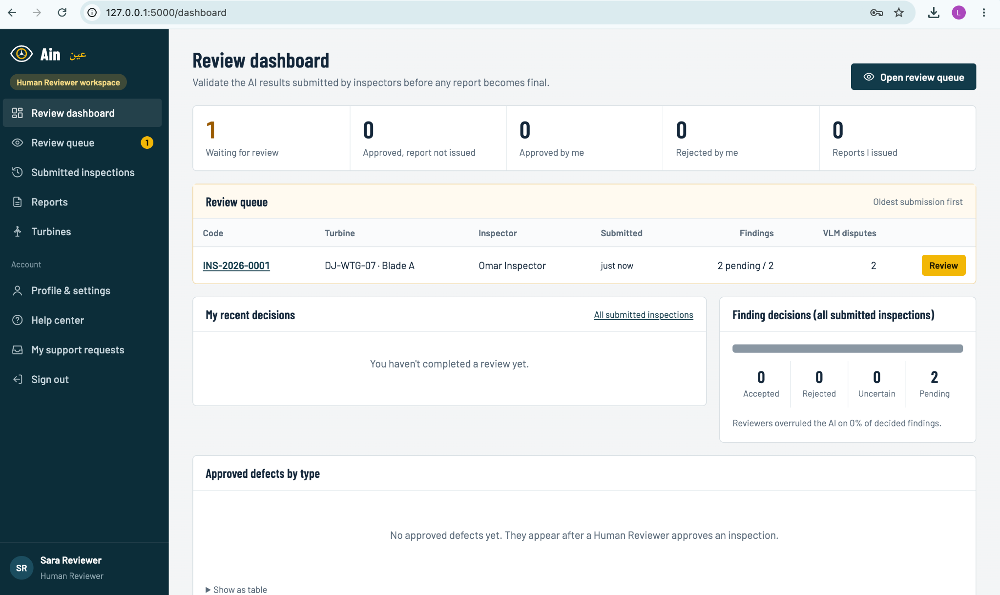
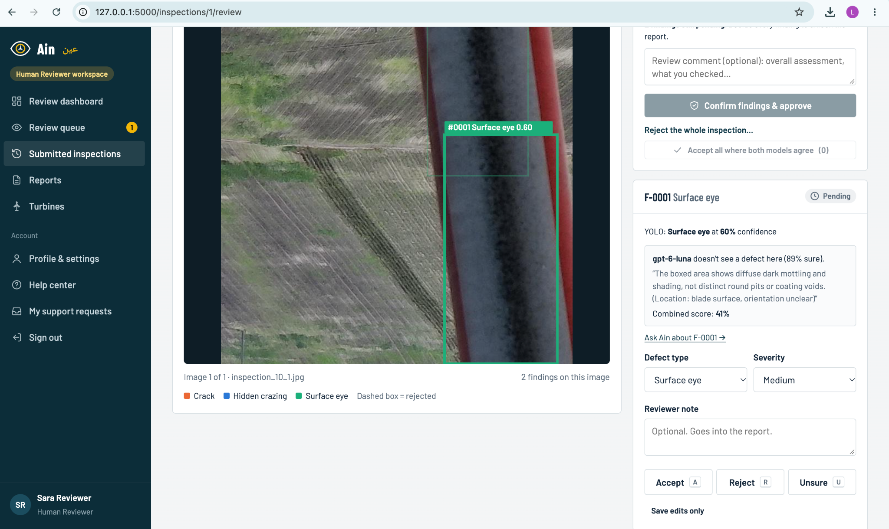
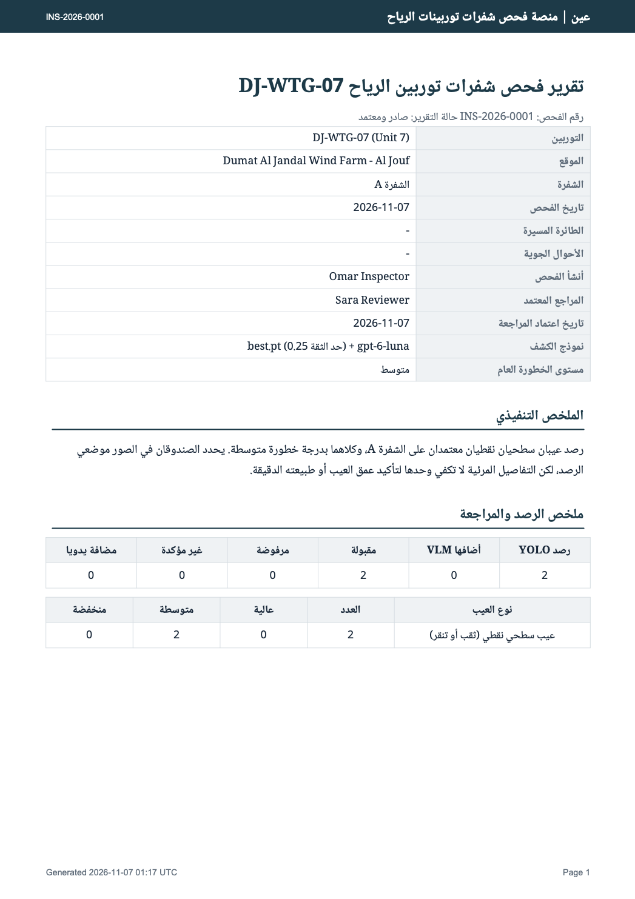
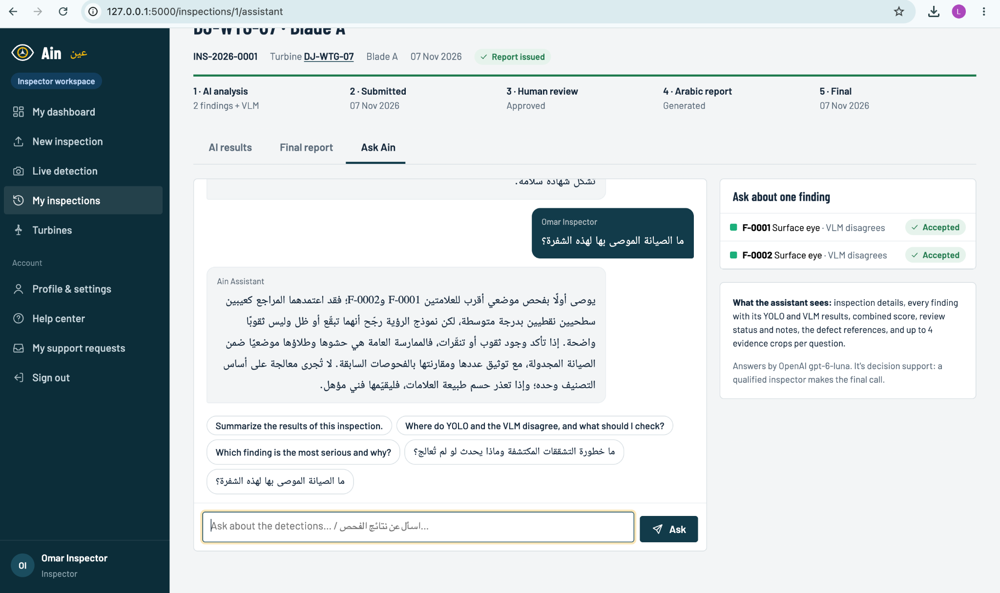

# AIN (عين) — AI-Powered Wind Turbine Blade Inspection Platform

**Senior Graduation Project · Prince Sultan University · College of Computer and Information Sciences · 2026–2027**

**Team:** Lama Bin Ekresh · Danyah Alsabti · Norah Aljasser · Yara Altwajari · Tala Alothaim  
**Supervisor:** Dr. Fatimah Alshannaq

AIN is a Flask web platform for **AI-assisted visual inspection of wind turbine blades** in UAV-captured images and videos. It connects **YOLO-based detection**, **vision-language model (VLM) verification**, **human review**, and **large language model (LLM)–assisted Arabic reporting** in a traceable workflow.

> **For examiners:** `models/best.pt` is included for local YOLO inference. The VLM, generative Arabic reporting, and Ask AIN require credentials for a supported AI provider. **No API keys are included in this repository.** Examiners can contact the project team directly for a key provided privately. See [Run AIN locally](#run-ain-locally) and [Examiner testing and API access](#examiner-testing-and-api-access).
>
> **Scope:** AIN is an academic decision-support prototype, **not** an autonomous safety certification or a replacement for qualified blade inspection.

## Contents

- [Overview and objectives](#overview-and-objectives)
- [Key features](#key-features)
- [Defect classes](#defect-classes)
- [Workflow and AI architecture](#workflow-and-ai-architecture)
- [Users and approval process](#users-and-approval-process)
- [Technology and repository layout](#technology-and-repository-layout)
- [Run AIN locally](#run-ain-locally)
- [Examiner testing and API access](#examiner-testing-and-api-access)
- [Model evaluation](#model-evaluation)
- [Screenshots](#screenshots)
- [Troubleshooting](#troubleshooting)
- [Limitations and responsible use](#limitations-and-responsible-use)
- [Team and acknowledgment](#team-and-acknowledgment)

## Overview and objectives

UAV inspections can capture large volumes of blade imagery without requiring personnel to work at height, but manually finding and documenting defects is time-consuming. AIN supports the steps **after image capture**: it identifies candidate surface defects, links them to their visual evidence, permits human verification, and prepares editable Arabic inspection reports.

The project aims to:

1. Detect and localize selected **visible** blade-surface defects in images and sampled video frames.
2. Preserve findings with classes, bounding boxes, confidence scores, source images, and video timestamps where applicable.
3. Cross-check candidate detections with a VLM and highlight disagreements.
4. Consolidate repeated observations of the same apparent defect across neighboring video frames.
5. Separate inspectors' work from reviewers' approvals through role-based permissions.
6. Generate editable **Arabic reports** and right-to-left PDFs from reviewed findings.
7. Offer an inspection-aware assistant for questions about results and evidence.

## Key features

| Feature | What AIN provides |
| --- | --- |
| Image and prerecorded-video inspections | Upload media for a selected turbine and blade; sample video frames for analysis. |
| YOLO detection | Bounding boxes, predicted class labels, and detection confidence. |
| VLM cross-check | Confirms, relabels, or rejects candidates; can suggest additional findings for review. |
| Evidence tracking | Associates findings with images or timestamped frames and inspection records. |
| Video deduplication | Consolidates repeated nearby-frame detections to reduce redundant findings. |
| Human-in-the-loop review | A separate reviewer accepts, edits, rejects, or flags findings before report issuance. |
| Arabic reporting | Once the reviewer resolves findings and approves the inspection, an Arabic draft can be generated even if all individual findings were rejected. With no accepted findings, the system uses an Arabic template. The reviewer can edit and issue it; the inspector then gains access. |
| Ask AIN | Inspection-specific Q&A in Arabic or English, using accessible findings and evidence. |
| Role-specific dashboards | Inspector, human reviewer, and administrator views and access rules. |
| Live detection | Separate interactive camera/image/video detection page; it does **not** replace the saved review-and-report workflow. |

## Defect classes

The included detection model, `models/best.pt`, uses three **dataset-specific** classes:

| Label | Description |
| --- | --- |
| `crack` | Visible surface crack or fracture-like mark. |
| `hide_craze` | Fine crazing or subtle crack-like surface pattern. |
| `surface_eye` | Localized surface-eye pattern as labeled in the training dataset. |

These are **model labels**, not an exhaustive engineering classification. RGB imagery alone cannot determine internal damage or crack depth.

## Workflow and AI architecture

```text
Inspector uploads blade images / videos
                   |
                   v
       YOLO detects candidate defects
                   |
                   v
        Optional VLM cross-check
                   |
                   v
        Inspector submits inspection
                   |
                   v
     Human reviewer decides on EVERY finding
       Accept / Edit / Reject / Uncertain
                   |
                   v
      Reviewer confirms review of inspection
             /                  \
            v                    v
  APPROVE INSPECTION       REJECT WHOLE INSPECTION
            |                    |
            v                    v
  Generate Arabic draft   Return to inspector for
  report, even if all     correction / resubmission
  findings were rejected  (no report generated at
            |             this rejected status)
            v
  If accepted findings: LLM-assisted report
  If zero accepted findings: Arabic template report
            |
            v
  Reviewer edits and ISSUES the final report
            |
            v
  Inspector views/downloads the ISSUED Arabic PDF
```

**Finding rejection and inspection rejection are different actions:**

- **Reject one or all individual findings:** This does **not** prevent report generation. Once the reviewer resolves all findings and approves the inspection, they can generate an Arabic draft. Only accepted findings are described as verified defects.
- **Zero accepted findings:** The application generates an **Arabic template-based report** documenting that no defects were approved. It does **not** call the LLM for this zero-accepted-findings case. A reviewer can still edit and issue this report.
- **Reject the entire inspection:** The separate **Reject the whole inspection** action returns the inspection to the inspector for correction/resubmission. The application blocks generating a report while the inspection has that rejected status.
- **Draft versus issued report:** The reviewer can generate/download a draft; the inspector can view/download the report only after the reviewer **issues** it.

For example, the project team tested an inspection with **two YOLO detections, both individually rejected**. AIN generated an Arabic **draft** reporting zero accepted defects. This demonstrates report generation after *finding rejection*, not after *whole-inspection rejection*.

### YOLO: candidate detection

The local Ultralytics/PyTorch detector supplies candidate regions, defect labels, and confidence scores. The model weights are stored in `models/best.pt`; inference is implemented in `core/services/detector.py`. Model path, image size, threshold, NMS IoU, and compute-device settings are documented in `app.py`. A low detection confidence is **not** a measure of structural safety.

### VLM: visual verification and confidence fusion

With an external AI provider configured, annotated detections and (when enabled) crops can be sent to a VLM. Its documented outcomes are:

| VLM outcome | Interpretation |
| --- | --- |
| **Confirmed** | Supports the YOLO class. |
| **Relabeled** | Suggests another supported class. |
| **Rejected** | Does not support the proposed detection. |
| **Added** | Proposes a candidate that YOLO may have missed. |

The implementation uses a **heuristic weighted fusion score**. With YOLO confidence \(Y\), VLM confidence \(V\), and weight \(w = \texttt{VLM_WEIGHT}\) (documented default `0.4`):

| Outcome | Documented score |
| --- | --- |
| Confirmed / relabeled | `(1 - w) × Y + w × V` |
| Rejected | `(1 - w) × Y + w × (1 - V)` |
| Added by VLM | `w × V` |

Reviewers can examine disagreements and low-score findings. **This score is not a calibrated probability or an independent performance metric.** The VLM decision never substitutes for human approval. Verification logic and prompts are in `core/services/vlm.py`, `core/services/vlm_prompts.py`, and `core/services/ai_client.py`. The prompts include examples of **normal blade features**—such as lightning receptors, drain holes, seams, shadows, dirt, and glare—that may resemble damage.

> **Implementation note:** The verdict-specific formulas were checked against `core/services/vlm.py` in the supplied AIN project. The configured default weight is `0.4` in `app.py`. This fused score is heuristic and should not be interpreted as calibrated model accuracy.

### LLM: Arabic reporting and Ask AIN

After all findings have been reviewed and the **inspection has been approved**, the reviewer can generate an Arabic report. The LLM uses **accepted findings** and their supporting evidence; rejected findings are excluded as confirmed defects. If the LLM is disabled, unavailable, or fails, the application can generate an Arabic template report instead. If **no findings are accepted**, the report writer uses the template fallback rather than an LLM call. The reviewer can edit the draft and issue it; only then can the owning inspector view/download the report. **Rejecting an entire inspection does not allow report generation until it is corrected and approved.**

**Ask AIN** provides questions and answers in Arabic or English using the relevant inspection's finding classes, model confidences, VLM verdicts/reasons, review status, notes, and available evidence. See `core/services/chat.py`, `core/services/report_writer.py`, `core/services/knowledge.py`, and `core/services/pdf.py`.

## Users and approval process

AIN enforces role and ownership restrictions on the server, not only by hiding navigation elements. Authorization logic is located in `core/permissions.py`.

| Role | Main capabilities | Restrictions |
| --- | --- | --- |
| **Inspector** | Create inspections; upload media; run/view detections; download evidence; use Ask AIN; submit for review; view an **issued** Arabic report for an owned inspection. | Cannot perform reviewer decisions, manage users, or inspect other inspectors' private records. |
| **Human reviewer** | See submitted inspections; inspect YOLO/VLM evidence; accept/edit/reject/flag individual findings; approve or reject the whole inspection; generate, edit and issue a report **only after inspection approval**. | Cannot see unsubmitted drafts or manage users. |
| **Administrator** | Manage users and roles, settings, audit information, and authorized review/report functions. | Administrative accounts should be restricted to trusted users. |

**Inspection lifecycle:** `Upload → YOLO/VLM analysis → Inspector submits → Reviewer resolves each finding → Approve whole inspection → Generate/edit draft Arabic report → Issue report → Inspector views issued report`. If the **whole inspection** is rejected instead, it returns for correction, and report generation is blocked until approval. Individual rejected findings do **not** block the approved inspection's report.

The separate `/live` interface supports interactive detection, but does not itself create an issued inspection report.

## Technology and repository layout

| Layer | Technologies |
| --- | --- |
| Backend | Python, Flask, SQLAlchemy and SQLite |
| Frontend | HTML, CSS, JavaScript, Jinja2 |
| Visual detection | Ultralytics YOLO, PyTorch, local `best.pt` weights |
| Optional generative AI | Configurable OpenAI or Gemini VLM/LLM services |
| Document output | Arabic right-to-left PDFs with ReportLab |
| Development | Git, GitHub, VS Code |

```text
AIN-Wind-Turbine-Inspection/
├── app.py                     # Flask entry point and inference settings
├── config.py                  # Application configuration
├── requirements.txt
├── models/
│   └── best.pt                # Trained YOLO weights
├── core/
│   ├── blueprints/            # Auth, inspections, review, live, reports, admin, etc.
│   ├── services/
│   │   ├── detector.py        # YOLO predictions
│   │   ├── vlm.py             # VLM verification
│   │   ├── vlm_prompts.py     # Visual verification guidance
│   │   ├── ai_client.py       # External AI service client
│   │   ├── worker.py          # Image/video background processing
│   │   ├── consolidate.py     # Repeated-finding consolidation
│   │   ├── chat.py            # Ask AIN
│   │   ├── report_writer.py   # Arabic report draft
│   │   └── pdf.py             # PDF export
│   ├── models.py              # Database models
│   ├── permissions.py         # Role/ownership checks
│   ├── templates/             # Pages and dashboards
│   └── static/                # Styles, scripts, fonts, assets
├── .gitignore
└── README.md
```

The local database, uploaded media, `.env`, virtual environments, and other runtime files are **not** part of the GitHub repository.

## Run AIN locally

### Prerequisites

- Python **3.11** (used in the project's local development setup)
- Git and an internet connection for installing dependencies and using external AI services
- Optional: an OpenAI or Gemini API key with access to the configured model
- Sufficient disk space and RAM for PyTorch/YOLO; video processing is typically slower on CPU

### 1. Clone the project

```bash
git clone https://github.com/lamaalekresh9/AIN-Wind-Turbine-Inspection.git
cd AIN-Wind-Turbine-Inspection
```

If this repository is private, request access from its owner before cloning. A QR code linking to a private repository does **not** grant access automatically.

### 2. Create a Python environment and install dependencies

**macOS / Linux**

```bash
python3.11 -m venv venv
source venv/bin/activate
python -m pip install -r requirements.txt
```

**Windows PowerShell**

```powershell
py -3.11 -m venv venv
.\venv\Scripts\Activate.ps1
python -m pip install -r requirements.txt
```

### 3. Configure API access (for examiners)

The team's API keys are **not included in GitHub** because they are private credentials. The included `models/best.pt` supports local YOLO detection, but the VLM, LLM-generated Arabic reporting, and Ask AIN's generative features need an AI provider key.

**Examiners who need to test these features can contact the AIN project team directly. We will provide an API key privately for the evaluation.** Do not put the key in the repository, README, screenshots, or GitHub Issues.

After receiving the evaluation key privately:

1. Create a file named `.env` in the root folder, next to `app.py`.
2. Add the matching variable for the key provided by the team:

   **For an OpenAI key:**

   ```dotenv
   OPENAI_API_KEY=PASTE_PROVIDED_KEY_HERE
   ```

   **For a Gemini key:**

   ```dotenv
   GEMINI_API_KEY=PASTE_PROVIDED_KEY_HERE
   ```

3. Select the corresponding provider and supported model in AIN's configuration. Check `app.py`, `config.py`, and `core/services/ai_client.py` for the exact settings in the current version.
4. Restart the Flask application. If available, use **Admin → Model & system → Test AI connection**, then test a small inspection.

The `.env` file is intentionally excluded by `.gitignore`. Keep the provided credential confidential and use it only for the agreed assessment. The team can revoke it afterward.

### 4. Start the application

```bash
python app.py
```

Open the URL printed by Flask (normally `http://127.0.0.1:5000`). On initial setup, the app may create a local SQLite database in `instance/` and seed demonstration data. The database is specific to the local machine; it will not be downloaded from GitHub.

### Demo sign-in accounts (local evaluation only)

On a **fresh local database**, AIN automatically creates these demonstration accounts when `SEED_DEMO_DATA=true` (the default). Open [`http://127.0.0.1:5000/login`](http://127.0.0.1:5000/login) **after starting AIN on your own computer**:

| Role | Email | Demo password | Purpose |
| --- | --- | --- | --- |
| **Inspector** | `inspector@ain.local` | `Inspect@123` | Upload images/videos, inspect YOLO/VLM results, submit inspections, and view issued Arabic reports. |
| **Human reviewer** | `reviewer@ain.local` | `Review@123` | Review submitted inspections, decide on individual findings, and generate/edit/issue reports. |
| **Administrator** | `admin@ain.local` | `Admin@123` | Manage users, roles, settings, and authorized administrative functions. |

**Examiner walkthrough:** First sign in as **Inspector** to upload and submit a test inspection. Sign out and use **Human reviewer** to decide on findings and produce/issue a report. Sign in again as **Inspector** to view the issued Arabic report. The administrator account is only for demonstrating administrative features. New users who register through sign-up are assigned the inspector role by default.

**Important:** These are deliberately shared **demo credentials defined in `core/seed.py`**, not private project-team passwords or API keys. They are appropriate **only for locally run, isolated evaluation copies**. **Never deploy an internet-accessible instance with these default users/passwords**, especially the administrator account. For deployments, disable demo seeding (`SEED_DEMO_DATA=false`), create unique accounts, set a strong `SECRET_KEY`, and restrict access. If the local database already exists, these passwords may not work if accounts were previously changed; demo seeding does not overwrite existing users. The local database is intentionally not committed to GitHub.

For custom administrator creation the app also provides:

```bash
flask --app app create-admin
```

The development utility `flask --app app reset-db` deletes local database contents; avoid using it unless you intentionally want to discard local records.

### 5. Check the AI connection

When using a provider key, ensure the selected provider/model in the application matches your account and has sufficient quota. The previous README describes an admin **Model & system → Test AI connection** feature; use it if present in the current build. Then test one small image and confirm the VLM's verdict appears separately from YOLO's prediction.

## Examiner testing and API access

| Capability | After clone, without external AI key | With a supported key |
| --- | --- | --- |
| Website, local records, permissions | Yes, after installation/account setup | Yes |
| YOLO detection using included weights | Yes | Yes |
| Review/approval process | Yes | Yes |
| VLM cross-check | No external VLM inference | Yes, subject to provider/model access |
| Arabic reporting | Template fallback may be available | AI-assisted drafting where configured |
| Ask AIN generative replies | Not available without an appropriate provider | Yes, where configured |

**Independent testing:** To use the VLM, LLM and Ask AIN generative features, examiners can **contact the AIN project team directly; we will provide the evaluation API key privately.** Follow [Configure API access](#3-configure-api-access-for-examiners) to add it locally. No real API key is included with a GitHub clone.

**Suggested evaluation walkthrough**

1. Log in as inspector and create an inspection for a selected turbine/blade.
2. Upload a defect image or a short sample video; inspect YOLO boxes, classes, scores, and evidence.
3. With an AI key configured, inspect VLM `confirmed` / `relabeled` / `rejected` decisions and disagreements.
4. Submit to a reviewer; demonstrate accepting valid findings and rejecting an individual incorrect finding.
5. Approve the inspection even if individual false-positive findings were rejected; generate, edit, then **issue** the Arabic report. Log in as the inspector and view/download the **issued** report. Separately demonstrate that rejecting the **entire inspection** returns it for correction and blocks report generation.
6. Ask a contextual question using Ask AIN; show the separate live-detection interface and PDF output if required.

Use **non-confidential test media** and have a no-defect example available. Test API connectivity before the assessment.

## YOLO model evaluation

The following are the **leakage-free group-split results** for **YOLO26m (640 px)**, recorded on **27 October 2026**. Related crops/tiles and near-duplicate source images were grouped into the same data split to reduce evaluation leakage.

**Dataset and experiment:** Forked Roboflow dataset `danyahs-workspace/wind-turbine-we2nt-ez1m6-vsgbq`, version 1 (no Roboflow augmentation), grouped using `group_split.csv`. The validation set contains **528 images (1,053 instances)** and the held-out test set contains **539 images (1,047 instances)**. Training stopped early at epoch **85 of 100** (patience: 25) on an **NVIDIA A100 40 GB**.

### Overall evaluation

| Split | Precision | Recall | mAP@0.5 | mAP@0.5:0.95 |
| --- | ---: | ---: | ---: | ---: |
| Validation | 0.681 | 0.670 | 0.660 | 0.323 |
| **Held-out test** | **0.746** | **0.687** | **0.685** | **0.335** |

### Per-class results — held-out test

| Class | Images | Instances | Precision | Recall | mAP@0.5 | mAP@0.5:0.95 |
| --- | ---: | ---: | ---: | ---: | ---: | ---: |
| `crack` | 314 | 698 | 0.897 | 0.894 | 0.913 | 0.520 |
| `hide_craze` | 54 | 96 | 0.745 | 0.625 | 0.589 | 0.231 |
| `surface_eye` | 169 | 253 | 0.597 | 0.542 | 0.552 | 0.252 |

Crack detection has the highest test mAP@0.5, while `hide_craze` and `surface_eye` are more challenging. Results reflect the named evaluation split; the installed `models/best.pt` checkpoint should be matched against the evaluated weights before describing these as the web application's exact inference metrics.

**VLM outcomes are different from detection metrics:** `confirmed`, `relabeled`, `rejected`, and `added` describe verification decisions. The YOLO–VLM fused confidence is a heuristic, not a replacement for precision, recall, or mAP.

## Screenshots

The screenshots below illustrate AIN's main workflow using demonstration inspection data. YOLO detections and VLM opinions are **candidate assessments**; a human reviewer is responsible for the final decisions.

### 1. AIN homepage



### 2. Inspector workspace and new inspection

The inspector manages inspections, uploads images or videos, and chooses detection settings.





### 3. YOLO detection and VLM cross-check

The annotated image shows candidate regions; individual findings retain YOLO confidences and optional VLM assessments. In this demonstration, the VLM disagrees with two `surface_eye` predictions; disagreements remain available for human review rather than being treated as automatic rejections.





### 4. Human review

The reviewer's dashboard shows submitted inspections, and the review interface supports accepting, rejecting, or editing individual findings. A reviewer can accept a finding even where the VLM disagrees.





### 5. Arabic inspection report

The issued right-to-left report documents the reviewer's decisions, inspection details, and assessment. This sample reflects reviewer-accepted findings, despite VLM disagreement.



### 6. Ask AIN inspection assistant

Ask AIN responds to inspection-specific questions using the accessible findings, review status, and evidence context.



## Troubleshooting

| Issue | Check |
| --- | --- |
| `ModuleNotFoundError` | Activate the virtual environment; reinstall `requirements.txt`. |
| YOLO model unavailable | Verify `models/best.pt` and the configured model path. |
| VLM/LLM unavailable | Check local `.env`, selected provider/model, account quota, and internet connection. |
| Report contains template text | Check whether an actual LLM call succeeded; template fallback is different from generated output. |
| Video analysis slow | Frame sampling, video size, CPU/GPU capability, and API latency. |
| `403` or inaccessible records | Role and record-ownership controls may intentionally deny access. |
| Data missing after clone | The SQLite database under `instance/` is local and excluded from Git. |

## Limitations and responsible use

- Detects selected **visible** defects in RGB images; no inference of hidden/internal damage, crack depth, or certified blade integrity.
- Performance can vary with lighting, motion blur, viewpoint, surface conditions, and distribution shift.
- The VLM and LLM can make mistakes. Human review is required; maintenance suggestions are informational, not authorized repair instructions.
- Does not autonomously control drones, predict remaining useful life, or integrate with live industrial control systems.
- Keep inspection imagery, accounts, and API credentials private as appropriate; do not upload confidential imagery to third-party AI services without authorization.

## Team and acknowledgment

**Senior Graduation Project — Prince Sultan University, College of Computer and Information Sciences (2026–2027)**

- Lama Bin Ekresh
- Danyah Alsabti
- Norah Aljasser
- Yara Altwajari
- Tala Alothaim

**Supervised by Dr. Fatimah Alshannaq.**

We thank Dr. Fatimah Alshannaq for her guidance and feedback, and Prince Sultan University for supporting this work.

---

*AIN (عين) supports evidence-based wind turbine blade inspection; it does not replace qualified professional judgment.*
