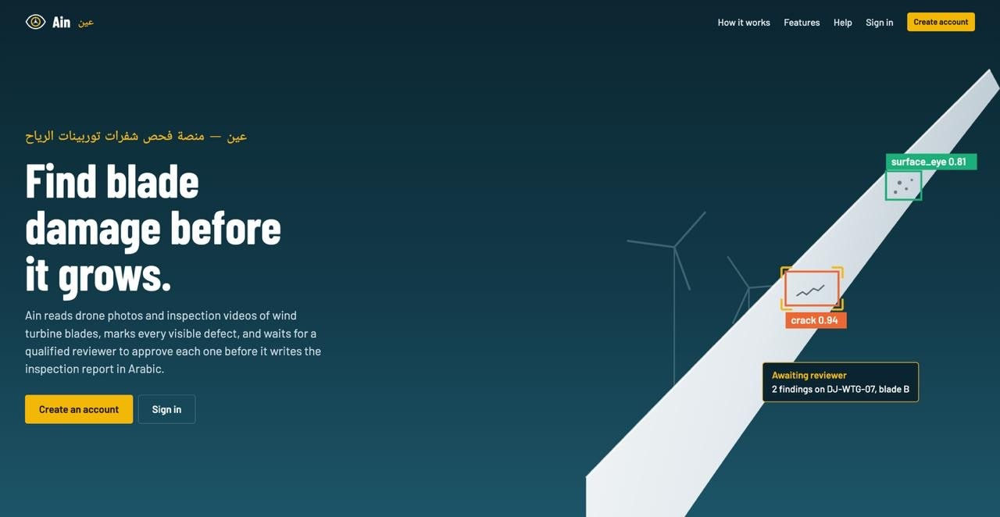
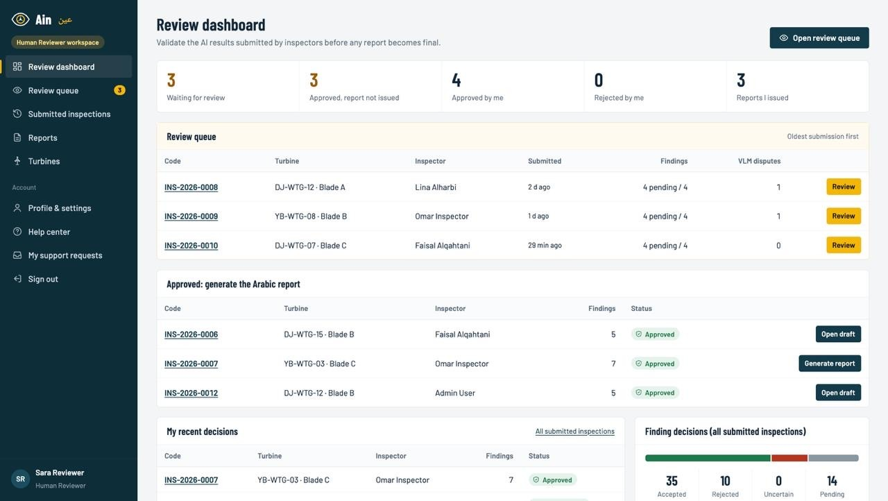
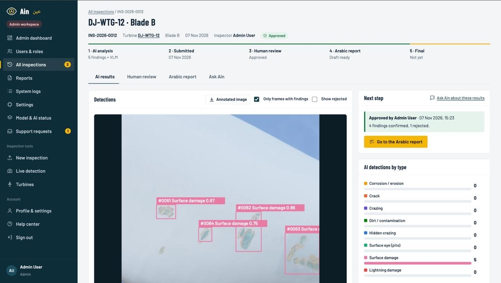
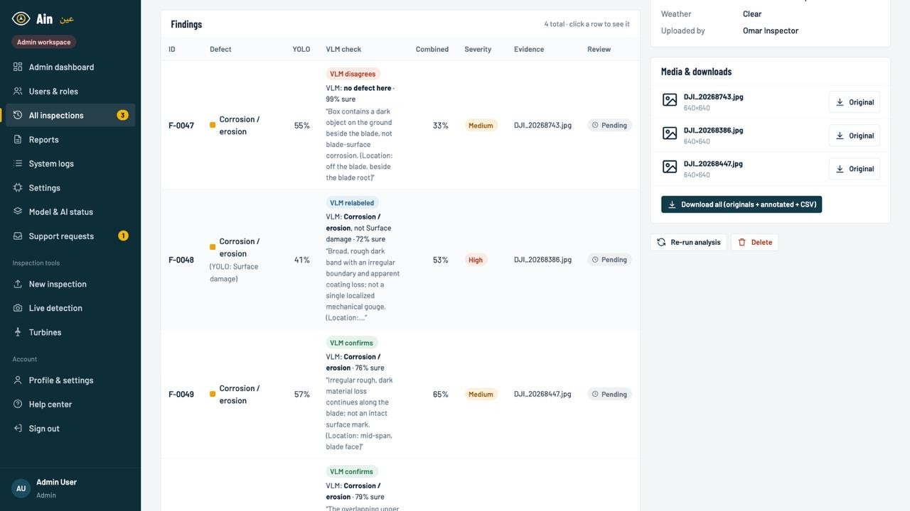
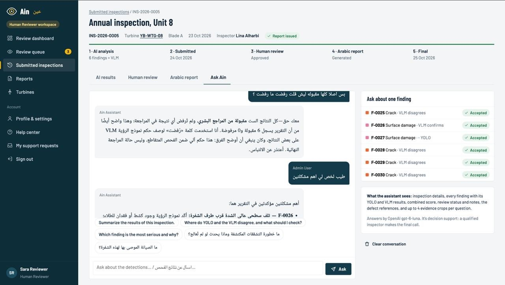
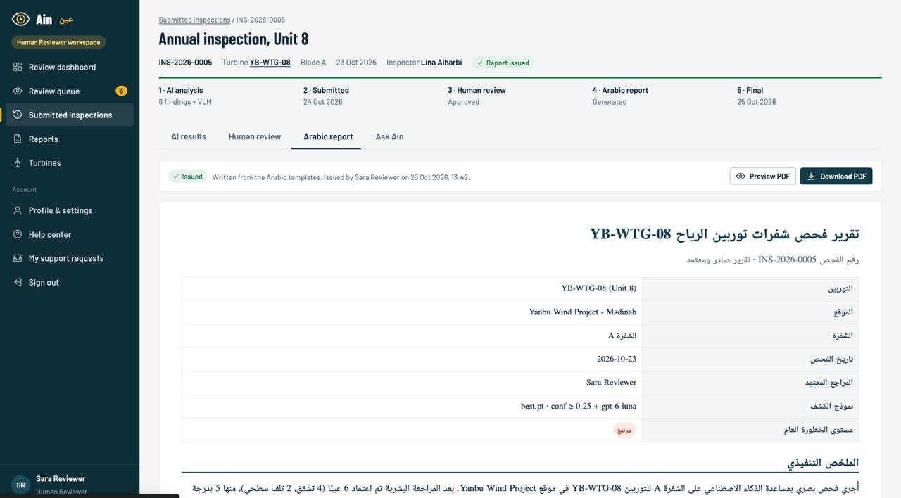
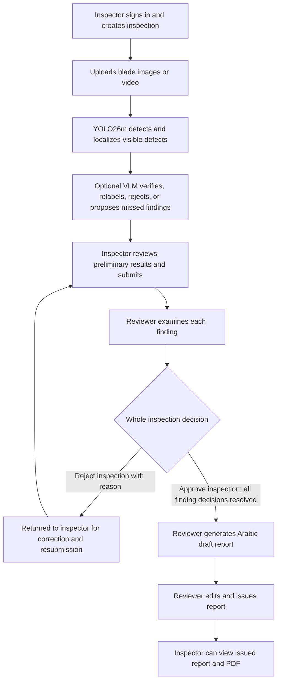

# AIN (عين) — AI-Powered Wind Turbine Blade Inspection

**Senior Project | Prince Sultan University | Academic Year 2026–2027**

AIN is a Flask-based platform for visual inspection of wind turbine blades from uploaded UAV/drone images and videos. It combines **YOLO26m object detection**, optional **vision-language model (VLM) cross-checking**, **human review**, and editable **Arabic inspection reports** with PDF export. The platform also includes an inspection-aware AI assistant and a live detection interface.

> **Scope:** AIN is a decision-support prototype for **visible surface defects**. A model prediction, VLM response, or generated recommendation is **not** a certified structural assessment. A qualified reviewer must inspect findings before a report is issued.

## Contents

- [At a glance](#at-a-glance)
- [Application screenshots](#application-screenshots)
- [Eight detected defect classes](#eight-detected-defect-classes)
- [Dataset and training methodology — Ain 10](#dataset-and-training-methodology--ain-10)
- [End-to-end inspection workflow](#end-to-end-inspection-workflow)
- [User roles](#user-roles)
- [Installation — macOS / Linux](#installation--macos--linux)
- [Seeded demo data](#seeded-demo-data--important-model-distinction)
- [Project map](#project-map)
- [Project team](#project-team)

## At a glance

| Component | Current implementation |
|---|---|
| Web application | Python, Flask, Flask-Login, Flask-SQLAlchemy, SQLite; HTML/CSS/JavaScript |
| Primary detector | **YOLO26m**, Ultralytics, 1024-pixel inference, `models/best.pt` |
| Defect taxonomy | **8 classes**, from merged WTBD + GFD-YOLOX WTBlade data |
| AI verification | Optional OpenAI/Gemini VLM, rule-based confidence fusion, human decisions |
| Reporting | Arabic LLM-assisted or offline-template draft, reviewer editing, RTL PDF |
| Roles | Inspector, Reviewer, Administrator; server-side authorization |
| Demo | Seeded accounts, **11 sample inspections**, **39 demonstration images** |

## Application screenshots

These images show the **AIN web application and its seeded demonstration cases**. The saved example detections and VLM responses were prepared with an earlier eight-class checkpoint and should **not** be interpreted as Ain 10 evaluation predictions. New analyses run the checkpoint currently configured in `models/best.pt` (see the [seed-data note](#seeded-demo-data--important-model-distinction)).

### 1. Landing page



### 2. Reviewer dashboard



### 3. Inspection AI results



### 4. YOLO + VLM evidence and confidence fusion



### 5. Ask AIN inspection-aware assistant



### 6. Arabic inspection report



> **Demo note:** The illustrated issued report is explicitly marked as generated using **Arabic templates**. LLM-assisted report generation is also supported when enabled and a provider is configured. Reviewer approval remains required for issuing a report.

## Eight detected defect classes

| Class (model label) | General description |
|---|---|
| `corrosion` | Corrosion-related visible deterioration |
| `crack` | Visible crack or fracture line |
| `craze` | Fine, shallow-looking cracking/crazing patterns |
| `dirt` | Distinct surface dirt, residue, or contamination patch |
| `hide_craze` | Dataset-specific hidden/faint craze appearance |
| `surface_eye` | Dataset-specific eye-like surface defect/mark |
| `surface_injure` | Visible damage to the blade surface |
| `thunderstrike` | Visible lightning-strike-related damage (dataset label) |

These are **dataset class labels**, not an assertion that image-only analysis can establish damage depth or cause. In particular, the meaning of `hide_craze` and `surface_eye` follows the source annotations.

## Dataset and training methodology — Ain 10

The eight-class **Ain 10** experiment uses **YOLO26m** with COCO-pretrained initialization, trained at **1024 × 1024 px**. The following dataset, training and result details are taken from the team's *Ain 10: Defect Detection Model — Results, Methodology and Web-App Integration* (7 November 2026) and are consistent with the values entered in `core/services/model_card.py`. The underlying training CSVs and notebook are held on the team Drive, **not** bundled in this repository.

### Source datasets and label harmonization

| Dataset | Images used | Original classes | Source annotation format |
|---|---:|---|---|
| WTBD (Wind Turbine Blade Defect) | **1,065** | corrosion, crack, craze, hide_craze, surface_injure, thunderstrike | Pascal VOC XML, annotator 1 |
| GFD-YOLOX WTBlade | **1,411** | corrosion, hide_craze, thunderstrike, dirt, surface_eye | Pascal VOC XML |
| **Merged** | **2,476** | **8 distinct classes; 4,431 labeled boxes** | Unified eight-class labels |

GFD originally contained 1,746 images; **335 near-copies of WTBD images were removed** before merging. The spelling of GFD's `hide-craze` and `surface-eye` was normalized to `hide_craze` and `surface_eye`. Equivalent classes shared by both sources (`corrosion`, `hide_craze`, `thunderstrike`) were merged; unique classes were retained. Only WTBD's first annotator was used for training; second-annotator labels were reserved for a separate agreement analysis.

The class distribution remains **imbalanced** (for example, `hide_craze` has 1,467 boxes versus 206 for `surface_eye`). **No class weights, oversampling, undersampling or loss reweighting** were applied. The splitting procedure aimed to preserve dataset/class representation across partitions; it did not equalize the underlying class frequencies. This differs from the earlier three-class Roboflow experiments, and their augmentation/split claims must **not** be attributed to Ain 10.

### Preventing near-duplicate leakage

Before splitting, images were grouped by perceptual similarity to keep rotated, mirrored, cropped or augmented variants on the same side of a split:

1. Compute a **256-bit 16 × 16 grayscale difference-from-mean perceptual hash** for each of eight rotation/flip orientations.
2. Treat two images as near-duplicates when the minimum **Hamming distance is ≤ 20 bits**, and transitively merge matched pairs using union-find.
3. Keep related GFD source/augmentation images together, and also join near-duplicate groups across WTBD and GFD.
4. Allocate entire groups—not individual images—to training, cross-validation or test. The reported audit found **zero near-duplicate pairs** crossing the test/development boundary or any validation/training fold boundary under this hash-based criterion.

The locked **held-out test set** contains **760 images (30.7%)** and **1,343 labeled boxes**, including **316 WTBD** and **444 GFD** images. The remaining **1,716 images (69.3%)** form the training/CV pool. Group-stratified allocation targeted approximately 30% of images and (dataset, class) boxes in test; the **GFD `dirt` test-box share was only 17%**, because its examples were concentrated in large near-duplicate groups. Split fingerprint: `14f5b1163bc61e7e`.

**Important limitation:** a large connected near-duplicate group of **923 images** (629 GFD + 294 WTBD) was assigned to **training only** to avoid crossing split boundaries. These images were **never in validation or test**. The remaining 793 development-pool images were divided into five rotating validation folds (approximately **156–160 validation images per fold**); each fold model trained on the other four folds **plus the 923 always-train images**. The team notes that the exact visual relationships inside this very large group have not all been manually audited. Thus the test assessment covers the remaining hold-out distribution rather than every type of image in the original corpus.

### Five-fold cross-validation and final training

- **Five fold models:** each trained for up to **120 epochs** with early stopping (`patience=30`), selecting the best validation checkpoint on its own fold.
- **Final epoch count:** the median best epoch from the five folds, **98**; the held-out test set was not used to choose it.
- **Final model:** trained once on **all 1,716 development-pool images** for exactly **98 epochs**, with `val=False`; the **last-epoch weights (`last.pt`)** were used as the final model, not a validation-selected `best.pt` from that final run. The application file is named `models/best.pt`, so that filename **does not establish** how the weights were selected. Confirm the file is the exported Ain 10 last-epoch checkpoint before claiming that the deployed weights reproduce the scores below.
- **Configuration:** Ultralytics **8.4.157**, PyTorch **2.14.1** / CUDA **13.0**, NVIDIA **A100 40 GB**; batch **8**; optimizer **AdamW**, initial LR **0.001**; cosine LR schedule; seed **0**, deterministic training.
- **Augmentation:** mosaic (`1.0`, disabled in the final 15 epochs), horizontal and vertical flips (`p=0.5` each), scaling (`±0.5`), and default HSV/translation jitter; rotation and mixup were set to **0**.
- **Evaluation settings:** 1024 px, validator confidence **0.001**, NMS IoU **0.6**. The application instead defaults to confidence **0.25** and NMS IoU **0.7**; these settings serve different purposes.

### Held-out test results — Ain 10 (YOLO detector only)

| Test subset | Images | Labeled boxes | Precision | Recall | mAP@0.5 | mAP@0.5:0.95 |
|---|---:|---:|---:|---:|---:|---:|
| **Combined WTBD + GFD** | **760** | **1,343** | **0.612** | **0.681** | **0.667** | **0.369** |
| WTBD only | 316 | 481 | 0.833 | 0.724 | 0.775 | 0.421 |
| GFD only | 444 | 862 | 0.528 | 0.615 | 0.555 | 0.301 |

The headline precision/recall are the Ultralytics validator's selected operating-point values, **not** necessarily the application's fixed-threshold behavior. Using the app confidence **0.25** (one-to-one box match at IoU 0.5), **combined precision = 0.664** and **recall = 0.614**; WTBD **0.733/0.728** and GFD **0.640/0.482**. The test results use a distinct test set and should not be directly compared as if head-to-head with the previous three-class Roboflow results. In particular, the earlier random-split result was contaminated by near-duplicate leakage and is **not a valid benchmark**.

### Cross-validation results

Each fold's metrics below are computed on **that model's unseen validation fold** (mean ± standard deviation across five folds):

| Validation subset | Precision | Recall | mAP@0.5 | mAP@0.5:0.95 |
|---|---:|---:|---:|---:|
| **Combined** | **0.620 ± 0.053** | **0.634 ± 0.041** | **0.661 ± 0.030** | **0.325 ± 0.005** |
| WTBD | 0.796 ± 0.071 | 0.719 ± 0.049 | 0.777 ± 0.055 | 0.415 ± 0.027 |
| GFD | 0.451 ± 0.096 | 0.541 ± 0.052 | 0.491 ± 0.045 | 0.191 ± 0.015 |

As an *additional stability check*, the five fold models were also scored on the same held-out test data; their **combined test mAP@0.5 was 0.641 ± 0.010** (not the final model's score). The final model scored **0.667**. These repeated test evaluations are descriptive checks, not separate independent test sets.

### Per-class detection performance

The experiment exported **AP@0.5** per class (not per-class precision/recall or mAP@0.5:0.95):

| Class | Test boxes | AP@0.5 overall | WTBD AP@0.5 | GFD AP@0.5 |
|---|---:|---:|---:|---:|
| `corrosion` | 416 | 0.349 | 0.448 | 0.323 |
| `crack` | 68 | 0.853 | 0.856 | — |
| `craze` | 77 | 0.840 | 0.913 | — |
| `dirt` | 41 | 0.898 | — | 0.902 |
| `hide_craze` | 457 | 0.630 | 0.788 | 0.576 |
| `surface_eye` | 62 | 0.231 | — | 0.233 |
| `surface_injure` | 126 | 0.776 | 0.838 | — |
| `thunderstrike` | 96 | 0.762 | 0.806 | 0.740 |

The weakest classes are **`surface_eye` (0.231)** and **`corrosion` (0.349)**. These results are for **YOLO detection alone**. The VLM, LLM-generated reporting, and subsequent human review were **not quantitatively evaluated** in the Ain 10 experiment, so their impact must not be presented as a measured improvement in model accuracy.

**Evaluation caveats:** the final 98-epoch training run's internally printed training-set metrics (including mAP@0.5 ≈ 0.907) **must not** be reported as test performance; the model used a single random seed; the 923 always-train images were not independently evaluated; and faint/small or cross-dataset defects remain a limitation. The figures in this README are drawn from the supplied results/methodology report and `model_card.py`. The experiment's raw result files (`results_test_final.csv`, `results_cv.csv`, `per_class_final.csv`, `summary.json` and `run_manifest.json`) are **not present here**, so the scores cannot be independently reproduced from the published code alone.

### Application inference thresholds

The app uses a **default YOLO confidence threshold of 0.25**, **NMS IoU of 0.70**, at most **300 detections per image**, and **1024 px inference** (`app.py`). Inspectors may change confidence for an inspection or live session. Do not confuse the application's confidence threshold with the **0.001 validator threshold** or with defect severity.

## End-to-end inspection workflow



**Two kinds of rejection are different:**

1. **Rejecting a finding** marks that detection as not accepted. A reviewer can reject **every individual finding** and still **approve the whole inspection** after resolving the review. A report can then be generated; with **zero accepted findings**, the code produces an **Arabic template-based draft** stating that there are no approved visible findings. It does **not** fabricate an LLM diagnosis.
2. **Rejecting the entire inspection** (for example, inadequate images) returns it to the inspector. Report generation is blocked in that whole-inspection-rejected state until the inspector corrects/resubmits and the reviewer completes review.

Only **accepted findings** are included as defect findings in the report; uncertain and rejected findings do not become approved defect claims. A report is a **draft** until a reviewer issues it; the inspector can access the **issued** report, not the reviewer's unissued draft. Reviewer/admin permissions are enforced on the server.

### VLM cross-check and confidence fusion

If enabled and a provider is configured, the VLM examines YOLO detections, annotated images and optional cropped evidence. For each detection it may **confirm**, **relabel**, or **reject** a box; it may also propose a missed defect. The configured fusion heuristic has `w = 0.4` (`app.py`):

| VLM response | Combined score heuristic |
|---|---|
| Confirmed or relabeled | `(1 − w) × YOLO_conf + w × VLM_conf` |
| Rejected | `(1 − w) × YOLO_conf + w × (1 − VLM_conf)` |
| VLM-added finding | `w × VLM_conf` |

With `VLM_MIN_COMBINED = 0.35`, low-scoring VLM-rejected boxes can be flagged as likely false positives; `VLM_AUTO_REJECT = False` by default, so they remain available for human adjudication. `VLM_MISSED_MIN_CONF = 0.60` limits newly proposed missed findings. These combined values are **heuristics, not calibrated probabilities or independently validated accuracy metrics**. Human review remains the final gate.

### Arabic reporting and Ask AIN

For an approved inspection with accepted findings and a configured AI provider, the report writer can use an LLM to draft Arabic summaries, defect-level evidence descriptions, risk considerations and maintenance suggestions. With no key, AI reporting disabled, or **zero accepted findings**, it uses Arabic templates. The reviewer can edit the draft, issue it and export an RTL PDF.

**Ask AIN** is an inspection-aware assistant that can use saved findings, confidences, VLM responses, reviewer decisions and selected evidence crops. Answers are guidance, not a substitute for human inspection. A live image detection interface with optional VLM cross-check is also available; live detections are not automatically saved as inspections.

## User roles

| Role | Main permissions |
|---|---|
| **Inspector** | Create/upload inspections, inspect detections, use chat and live mode, download own evidence, submit/resubmit after whole-inspection rejection, view issued reports for own inspections |
| **Reviewer** | View submitted inspections, resolve findings (including editing/rejecting), add findings, approve or reject entire inspections, generate/edit/issue reports |
| **Administrator** | Manage users, turbines, settings and audit information; access review and report tools |

**All new users who sign up through `/signup` are automatically created as Inspectors.** Reviewer and Admin permissions are not selectable during public sign-up; authorized administration is required to change roles.

## Installation — macOS / Linux

**Requirements:** Python with compatible PyTorch/Ultralytics support (Python 3.11 is a practical option), local disk space for the model and dependencies, and an internet connection for optional hosted AI services.

```bash
# Run these inside the extracted project folder
python3.11 -m venv venv
source venv/bin/activate
python -m pip install --upgrade pip
python -m pip install -r requirements.txt
cp .env.example .env
python app.py
```

Open **http://127.0.0.1:5000**. If `python3.11` is unavailable, use a compatible installed `python3` instead. On Windows, activate using `venv\Scripts\activate` and copy the example environment file using `copy .env.example .env`.

On first run, the app creates a local SQLite database in `instance/` and, with `DEMO_DATA = True` and `SEED_DEMO_DATA=true`, seeds demo users and sample inspections. **Use these demo sign-in credentials** (local demonstration accounts only):

| Role | Email | Password |
|---|---|---|
| Admin | `admin@ain.local` | `Admin@123` |
| Reviewer | `reviewer@ain.local` | `Review@123` |
| Inspector | `inspector@ain.local` | `Inspect@123` |

Additional demonstration users are described in the bundled `DEMO_CASES.md` and `demo_data/manifest.json`. Demo accounts use known passwords and **must not be enabled on a publicly hosted deployment**. Change credentials, disable demo seeding and harden authentication before production deployment.

**The published GitHub repository is source code, not a running website.** Examiners should clone/download it, install dependencies and run the local app to sign in.

### First-run access checklist

1. Open the local site at `http://127.0.0.1:5000` and sign in using one of the seeded demo accounts above (on a fresh database with demo seeding enabled).
2. Test a new image as **Inspector**, submit it, and sign in as **Reviewer** to resolve every finding and approve/reject the inspection.
3. For an approved inspection, generate and review an Arabic report, issue it, then sign in as **Inspector** to view the issued PDF.
4. Anyone using the public **Sign up** page receives the **Inspector** role. Admin or Reviewer access requires an authorized role assignment.

### Optional hosted AI API setup

The YOLO detector works without any hosted AI key. The VLM, LLM reporting and hosted assistant features require configured service credentials. For the academic demonstration, **contact the project team directly for a temporary API key and setup guidance**; the key must be shared privately and never committed to GitHub.

1. Open the local `.env` file created from `.env.example`.
2. Set `OPENAI_API_KEY=...` or `GEMINI_API_KEY=...` using the credential provided privately.
3. Review `AI_PROVIDER` and AI model settings in `app.py`; the model identifiers shown there must be supported by the selected provider/account.
4. Restart the app and, as an admin, use **Model & system → Test AI connection**.

Without working hosted AI access, the app supports YOLO detection, human review and template-based Arabic reports. API provider usage may incur charges. Do not include real keys, tokens, or personal inspection data in a public repository.

### Settings and useful commands

The top of `app.py` controls model path, default confidence/IoU/image size, CPU/GPU selection, hosted AI configuration, VLM heuristics and report/chat settings.

```bash
flask --app app reset-db      # DESTRUCTIVE: erase local database and reseed demo data
flask --app app create-admin  # create a local administrator
```

`reset-db` deletes local inspection history; use only in a disposable demo environment. The application disables Flask auto-reload because video analysis uses background threads.

## Seeded demo data — important model distinction

The package ships **39 sample blade photos**, **11 sample inspections** across different review/report statuses, saved VLM responses and related sample users/turbines. See [`DEMO_CASES.md`](DEMO_CASES.md).

**Do not claim that the seeded sample boxes were produced by the current Ain 10 model.** Their original YOLO boxes were generated by an **earlier merged v1.2 checkpoint**, and the saved VLM responses are demonstration artifacts. This older evidence was intentionally retained to illustrate reviewer scenarios. **Creating a new inspection or using “Re-run analysis” runs the checkpoint at `models/best.pt`**. Its association with the Ain 10 training artifact requires verification against the original exported weights. The 39 demo images include WTBD test photographs associated with the earlier model and WTBs2025 images; do not present the preloaded demo findings as an independent benchmark of the newer checkpoint.

The dataset photo rights and redistribution conditions should be confirmed with the dataset owners before distributing demo image assets under a public license.

## Project map

```text
app.py                         Flask entry point and model/AI settings
config.py                      environment and application settings
requirements.txt               Python dependencies
.env.example                   safe configuration template (not an API key)
models/best.pt                 configured eight-class YOLO26m checkpoint (provenance to verify)
DEMO_CASES.md                  walkthrough of seeded review examples
demo_data/                     demo image assets, manifest and saved VLM output
core/
  __init__.py                  application factory, database initialization
  models.py, permissions.py    persistence and role checks
  seed.py, demo_data.py        demo setup
  blueprints/                  authentication, inspection, review, report, admin, live routes
  services/
    detector.py                image inference
    worker.py                  image/video processing and frame sampling
    consolidate.py             duplicate consolidation
    vlm.py, vlm_prompts.py     VLM review and prompt design
    ai_client.py               hosted provider client
    report_writer.py, pdf.py   Arabic report drafting and PDF export
    knowledge.py               offline Arabic reference templates
    model_card.py              embedded evaluation results and protocol
  templates/, static/          interface, JavaScript, CSS, assets
instance/                      local database/uploads (ignored by Git)
```

### Implemented functionality and limitations

- Optional blade segmentation in `detector.py` is a **passthrough unless a blade segmentation model is configured**; do not describe it as an active trained segmentation stage by default.
- Video processing samples frames and consolidates related detections; this is not UAV flight control or guaranteed continuous real-time streaming.
- The app's browser camera mode requires localhost or HTTPS for normal camera permissions. No deployment infrastructure is included in this repository.
- The forgot-password form is a demonstration flow; it **does not send email or actually reset passwords**.
- Small defects, poor visibility, domain changes and class ambiguity may reduce accuracy, particularly for lower-performing classes; the held-out metrics above should be interpreted in the context of the merged sources.
- The source package contains an embedded evaluation model card but **not the training experiment files** required for complete independent reproduction of the reported metrics.

## Project team

**Prince Sultan University** — Senior Project (2026–2027)  
**Supervisor:** Dr. Fatimah Alshannaq  
**Team:** Lama Bin Ekresh, Danyah Alsabti, Norah Aljasser, Yara Altwajari, Tala Alothaim.

**Repository:** https://github.com/lamaalekresh9/AIN-Wind-Turbine-Inspection

> Academic prototype. Do not use automatically generated findings or maintenance suggestions as the sole basis for operational safety decisions.
